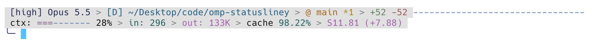

# omp-statusliney

A fully customizable statusline for [Oh My Pi](https://omp.sh) (`omp`). It replaces the built-in statusline completely, including the startup prepaint, and draws a multi-line bar like ccstatusline. It keeps all 27 built-in segments and adds 25 new widgets.



## Requirements

- omp `>=18.12.2 <19`
- Bun `>=1.3.14` (omp already runs on Bun)

## Installation

omp-statusliney is an omp plugin. It does not work in upstream pi, because it hooks into omp's own statusline.

### From npm

```sh
omp plugin install omp-statusliney
```

### From the omp marketplace

This repository is also an omp marketplace catalog (`.omp-plugin/marketplace.json`):

```sh
omp plugin marketplace add ignissak/omp-statusliney
omp plugin install omp-statusliney@ignissak
```

Marketplace installs track the `main` branch. Use `omp plugin upgrade omp-statusliney@ignissak` to update.

### From a local checkout

```sh
git clone https://github.com/ignissak/omp-statusliney.git
cd omp-statusliney
bun install
omp plugin link "$PWD"
```

`omp plugin link` points omp at the checkout, so later source changes take effect the next time omp starts.

Install omp-statusliney only one way at a time. omp refuses a second copy of a package it already has.

### Check the install

```sh
omp plugin doctor   # should list "plugin:omp-statusliney"
omp                 # the new bar replaces the built-in one
```

On first launch the plugin writes `~/.omp/agent/statusliney.json` with a layout built from your current built-in statusline segments. On the band and box composers it looks the same as the built-in bar. On shapes where the bar sits below the prompt, it uses your configured separator instead of the built-in plain dots.

### Uninstall

```sh
omp plugin uninstall omp-statusliney
```

The built-in statusline returns on the next launch. The config file stays in place; delete `~/.omp/agent/statusliney.json` to remove it.

## Configuration

Run `/statusliney-settings` in the TUI. Each change applies to the live bar right away and is saved automatically.

- **Lines & widgets**: 1–6 lines. Add (`a`), insert (`i`), delete (`d` twice), move (`[` `]`) and clone (`c`) widgets. Set each widget's color (theme tokens only), bold, label and options.
- **Appearance**: placement (`auto` puts the bar in the composer frame when it has one, otherwise below the prompt; or force `top`/`bottom`), separator (`inherit` follows `statusLine.separator`), background, hook status rows, refresh intervals.
- **Presets**: the built-in presets, `Two-line dev` and `Focused`. Moving through the list previews each preset on the live bar. Enter applies it; Esc restores your layout.
- **Reset to built-in layout**: copy your current built-in statusline settings again.

You can also edit the JSON by hand; the plugin picks up external edits while omp is running. Set `OMP_STATUSLINEY_CONFIG` to use a different file.

The bar follows omp's theme and symbol preset (all glyphs and colors come from the theme). It also honors your `statusLine.*` preferences (segment options, transparent, session accent, compact thinking level, context line, hook status) and the composer shape.

### Widgets

| Category | Widgets |
|---|---|
| omp built-in | every built-in segment (`pi`, `model`, `path`, `git`, `pr`, `cost`, `context_pct`, `session_name`, `usage`, `vim`, …) |
| Git | `git_ahead_behind`, `git_sha`, `git_changes`, `git_stash`, `git_clean` |
| Context | `context_gauge` (the built-in context rule), `context_bar`, `context_remaining`, `quota_bar` |
| Session | `cost_rate`, `turns`, `compactions`, `session_clock`, `tool` |
| Environment | `jobs`, `thinking`, `provider`, `omp_version`, `terminal_width`, `memory` |
| Custom | `text`, `custom_command` (first output line, cached), `link` (OSC 8) |
| Layout | `separator`, `flex` |

## Local development

### Setup

```sh
bun install
```

This installs the `@oh-my-pi/*` packages as dev dependencies for types and tests. At runtime omp maps every `@oh-my-pi/*` import to its own bundled modules, so the plugin always runs against the live host.

The plugin is TypeScript that Bun runs directly; there is no build step. The entry point is `src/index.ts`, declared under `omp.extensions` in `package.json`.

### Run omp with your working copy

Load the checkout as an extension without installing it, and use a scratch config so your real one is untouched:

```sh
export OMP_STATUSLINEY_CONFIG=/tmp/sly/statusliney.json
omp --no-session -e "$PWD"
```

- `--no-session` skips writing a session file.
- Add `--no-extensions` to load only this plugin, without your other plugins.
- Restart omp after each source change.
- Delete the scratch config to start again from the mirrored built-in layout.

### Tests and type checks

```sh
bun test            # config normalization, store round-trip, layout engine, presets
bun run typecheck   # tsc --noEmit
```

### Project layout

| Path | Purpose |
|---|---|
| `src/index.ts` | Plugin entry: events, ticker, `/statusliney-settings` command |
| `src/takeover.ts` | Patches omp's `StatusLineComponent`, captures the live segment context, scrubs the startup cache |
| `src/frame.ts` | Placement, surfaces, hook rows, per-frame rendering |
| `src/layout.ts` | Pure line layout: groups, separators, flex fill, overflow |
| `src/config.ts`, `src/store.ts` | Config schema, validation, atomic save, file watch |
| `src/presets.ts` | Built-in mirror and named presets |
| `src/widgets/` | Widget contract, registry and widget implementations |
| `src/ui/` | Settings overlay and its views |
| `test/` | Bun tests |

### Debugging

- Plugin messages go to omp's log file, `~/.omp/logs/omp.<DATE>.<PID>.log`, which records every level by default. Filter with `grep statusliney`. Set `OMP_LOG_LEVEL` (`error|warn|info|debug`) to limit what is written.
- The plugin patches omp internals. If an omp release removes a member it patches, the plugin leaves the built-in bar in place and shows a `statusliney: unsupported omp internals` warning. If rendering keeps failing at runtime (three frames in a row), it restores the built-in bar and warns. Fix the patch targets in `src/takeover.ts` (`canTakeOver`).
- On native TSP terminals the plugin passes your real settings through, so the terminal's own statusline is unchanged.

## Releasing

Releases are automated by `.github/workflows/release.yml`. To release, bump `version` in `package.json` and push it to `main`:

```sh
npm version minor --no-git-tag-version   # or patch / major, or edit package.json by hand
git commit -am "chore(release): 1.1.0"
git push
```

The workflow then:

1. Runs the tests and the type check.
2. Publishes the version to npm with provenance, unless it is already there.
3. Creates the tag `v<version>` and a GitHub release. The release notes come from the commits since the previous tag, grouped by their Conventional Commit type (breaking changes, features, fixes, other). Version-bump commits are left out.

Each step skips itself if it is already done, so a failed run can simply be re-run. Preview the notes locally with `bun scripts/release-notes.ts v1.1.0`.

The npm package carries the `pi-package` keyword and a `pi.image` preview, so it also appears in the [pi package gallery](https://pi.dev/packages) once it is on npm.

### One-time setup

npm only allows trusted publishing for a package that already exists, so the first version is published by hand:

1. `npm login`, then `npm publish --access public` from a clean checkout of `main`.
2. On npmjs.com, open the package's **Settings → Trusted publishing** and add GitHub Actions with repository `ignissak/omp-statusliney` and workflow `release.yml`.
3. Push `main`, or run the **Release** workflow by hand. It sees the version already on npm, so it only creates the tag and the release.

After that, no npm token is needed: the workflow authenticates through GitHub's OIDC token.
